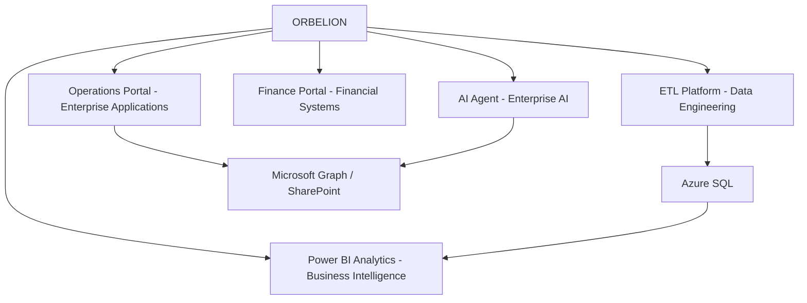

# ORBELION

### Enterprise Technology Platform

**Data Engineering · Cloud Integration · Business Applications · Analytics · Automation · AI**

Technology ecosystem focused on designing and implementing enterprise solutions across data, applications, analytics, cloud infrastructure and artificial intelligence.

---

## ORBELION Ecosystem

---

## Featured Projects

### ORBELION ETL Platform

Metadata-driven Python ETL platform for multi-source data integration, transformation, Azure SQL analytics and automated data pipelines.

**Core:** Python · Pandas · SQL · Azure SQL · APIs · GitHub Actions

**[View Project →](https://github.com/Orbelion-Platform/ORBELION-ETL-Platform)**

### ORBELION Operations Portal

Enterprise operations portal designed for client management, implementations, integrations and secure business workflows.

**Core:** TypeScript · Microsoft Graph · SharePoint · Azure · Cloudflare

**[View Project →](https://github.com/Orbelion-Platform/ORBELION-Operations-Portal)**

### ORBELION Finance Portal

Financial management application focused on structured financial workflows, analytics and data-driven operations.

**Core:** TypeScript · Cloudflare D1 · Drizzle ORM · SQL · Data Visualization

**[View Project →](https://github.com/Orbelion-Platform/ORBELION-Finance-Portal)**

### ORBELION Power BI Analytics

Business intelligence project showcasing semantic modeling, DAX, KPI design, PBIP development and version-controlled analytics.

**Core:** Power BI · PBIP · DAX · Power Query · Semantic Modeling · Azure SQL

**[View Project →](https://github.com/Orbelion-Platform/ORBELION-PowerBI-Analytics)**

### ORBELION AI Agent

Enterprise AI agent built around secure tool calling, structured outputs and read-only integration with enterprise information sources.

**Core:** Python · FastAPI · OpenAI Agents SDK · Microsoft Graph · SharePoint · Azure Container Apps

**[View Project →](https://github.com/Orbelion-Platform/ORBELION-AI-Agent)**

---

## Technology Stack

### Data & Analytics

Python · Pandas · SQL · Azure SQL · Power BI · DAX · Power Query

### Application Development

TypeScript · FastAPI · REST APIs · Drizzle ORM · Cloudflare D1

### Microsoft & Cloud

Azure · Microsoft Graph · SharePoint · Microsoft Entra ID · Azure Container Apps

### AI & Automation

OpenAI Agents SDK · Tool Calling · Structured Outputs · GitHub Actions

### Infrastructure & DevOps

GitHub · GitHub Actions · Docker · Cloudflare

---

## Engineering Approach

ORBELION projects demonstrate an engineering approach centered on:

- Modular and reusable architecture
- Separation of application, data and integration layers
- Secure enterprise integrations
- API-driven interoperability
- Configuration-driven systems
- Automated data pipelines and workflows
- Analytical and semantic data modeling
- Version-controlled development

---

## Project Evidence

Real, sanitized project screenshots and technical execution evidence will be incorporated for:

**ETL Platform · Operations Portal · Finance Portal · Power BI Analytics · AI Agent**

---

## About the Implementer

**Axel Ortega**

Technology Implementer · Data, Cloud & AI Solutions  
Costa Rica

Focused on implementing enterprise applications, data engineering platforms, analytics, cloud integrations, automation and AI-enabled solutions.

---

### ORBELION

**Enterprise Technology · Data · Cloud · Analytics · AI**

