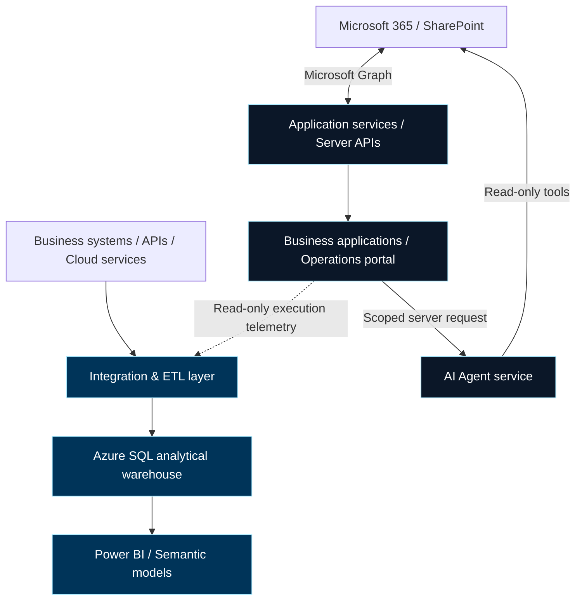

# ORBELION

Enterprise Technology Solutions

<strong>Enterprise Technology · Cloud · Business Systems · Data & Analytics · Artificial Intelligence</strong>

Engineering connected business systems, dependable data pipelines and evidence-backed AI.

[Corporate Website](https://orbelion.com) · [Engineering Portfolio](#engineering-portfolio)

---

## Technology Solutions

| Practice | Engineering focus |
| --- | --- |
| **01 — Cloud & Infrastructure** | Cloudflare and Microsoft Azure; application infrastructure, APIs, containers, identity and security boundaries. |
| **02 — Business Systems** | Business applications, ERP and CRM integration, Microsoft 365 workflows and process automation. |
| **03 — Data & Analytics** | Data engineering, ETL, SQL data warehousing, Power BI semantic models and decision dashboards. |
| **04 — Artificial Intelligence** | Model API integration, scoped agents, typed enterprise tools and intelligent workflow orchestration. |

## Enterprise Architecture

Distinct analytical and application paths preserve service ownership. This summarizes documented integration patterns, not a single shared deployment.

Application storage belongs to each service boundary. The Agent reads Microsoft 365 through scoped tools; no direct Agent-to-warehouse integration is claimed. ETL operational telemetry is separate from analytical data consumption.

## Engineering Portfolio

Public repositories are curated engineering artifacts. Their documentation distinguishes private implementation evidence, runnable public examples and future work; availability here does not imply a production-ready distribution.

| Project | Technical purpose & implemented capabilities | Core technologies |
| --- | --- | --- |
| **[ORBELION ETL System](https://github.com/Orbelion-Platform/ORBELION-ETL-Platform)** | Metadata-driven ingestion and analytical loading; source connectors, schema validation, watermarks, audit records and a synthetic local demo. | Python, pandas, YAML, SQLAlchemy, Azure SQL, Docker |
| **[ORBELION Operations Portal](https://github.com/Orbelion-Platform/ORBELION-Operations-Portal)** | Role-aware delivery workspace; SharePoint records, controlled writes, read-only ETL telemetry and an evidence-oriented assistant. Public case study with representative code. | TypeScript, React, Next.js, Cloudflare Workers, Microsoft Graph |
| **[ORBELION Power BI Analytics](https://github.com/Orbelion-Platform/ORBELION-Power-BI)** | Dimensional modeling, centralized DAX measures and functional report pages. Sanitized examples and explicitly synthetic dashboard evidence. | Power BI, PBIP, PBIR, TMDL, DAX, Power Query, Azure SQL |
| **[ORBELION AI Agent](https://github.com/Orbelion-Platform/ORBELION-AI-Agent)** | Read-only operational assistant; typed tool calls, client-scoped retrieval, structured evidence and explicit live-execution gates. Public architecture and synthetic contracts. | Python, FastAPI, OpenAI Agents SDK, Pydantic, Microsoft Graph, Azure Container Apps |
| **[ORBELION Automations](https://github.com/Orbelion-Platform/ORBELION-Automations)** | Shared CLI/API execution boundary, validated configuration and explicit failure handling. Public synthetic example; documented framework remains a local development foundation. | Python, FastAPI, typed YAML, registered jobs and connectors |

### Selected Visual Evidence

*Power BI executive overview — synthetic demonstration data, not customer performance.*

Additional evidence: [ETL workflow](https://github.com/Orbelion-Platform/ORBELION-ETL-Platform/blob/main/docs/assets/etl-workflow.png) · [Operations screenshots](https://github.com/Orbelion-Platform/ORBELION-Operations-Portal#product-evidence) · [Agent screenshots](https://github.com/Orbelion-Platform/ORBELION-AI-Agent#product-evidence) · [Automations workflow and limitations](https://github.com/Orbelion-Platform/ORBELION-Automations#workflow-overview).

Additional ecosystem projects — public evidence pending

ORBELION Portal General, ORBELION Finance Portal, ORBELION Analytics Dashboard, ORBELION Skills Library and ORBELION Content Studio are reserved for future evidence-backed portfolio entries. A verified public repository with sufficient technical documentation was not available for these entries at review time; no implementation or release claim is made here.

## Security & DevSecOps

Controls are evaluated per project and trust boundary.

| Area | Documented implementation & current boundary |
| --- | --- |
| **Git & delivery** | Git-versioned artifacts and GitHub Actions workflows in ETL; the Agent case study documents Docker delivery to Azure Container Apps using OIDC. Public case studies do not all ship deployment workflows. |
| **Identity & authorization** | Operations documents trusted hosting identity headers and role checks; Microsoft Entra ID supplies server-side Graph credentials. The Agent documents production bearer authentication and client-scope checks without claiming per-user federation. |
| **Secrets** | Server-only runtime configuration, placeholder public examples and managed/workload identity where documented. ETL Key Vault configuration is an example requiring external setup. |
| **Application boundaries** | Cloudflare Worker server routes separate browsers from upstream systems; Agent tools expose read-only retrieval. These controls are project-specific. |
| **Observability** | ETL run audits and watermarks, portal write-audit events, and Agent request identifiers, evidence and warnings. A unified monitoring platform is not claimed. |
| **Row Level Security** | No ecosystem-wide database RLS implementation is asserted. Application client filtering must not be described as database-enforced RLS. |
| **Release discipline** | Branching, Pull Requests, environment separation and scoped review are engineering principles. Uniform branch enforcement and isolated staging across every project remain unverified. |

**In development:** Automations requires durable reservations, recovery, tenant-bound authorization, scheduling and production monitoring before release. CI results, cloud configuration and access policies require target-environment verification; a local test result is not runtime proof.

## Technology Ecosystem

| Category | Technologies represented in the documented projects |
| --- | --- |
| **Languages & Frameworks** | Python, TypeScript, React, Next.js, FastAPI, Pydantic |
| **Cloud & Infrastructure** | Cloudflare Workers, Microsoft Azure, Azure Container Apps, Docker |
| **Data Engineering** | pandas, SQL, YAML metadata, SQLAlchemy, Azure SQL, REST and Odoo connectors |
| **Analytics & BI** | Power BI, PBIP, PBIR, TMDL, DAX, Power Query M |
| **Enterprise Integrations** | Microsoft Graph, SharePoint Online, Microsoft Lists, Microsoft 365, Odoo XML-RPC |
| **Artificial Intelligence** | OpenAI API, OpenAI Agents SDK, function tools, structured outputs |
| **Security & Identity** | Microsoft Entra ID, Azure Identity, OAuth 2.0, managed/workload identity, OIDC; Key Vault configuration examples |
| **DevOps & Automation** | Git, GitHub, GitHub Actions, pytest, Ruff, Node test runner, CLI/API execution |

## Engineering Principles

| Principle | Practical commitment |
| --- | --- |
| **Modular Architecture** | Separate application, integration and analytical responsibilities. |
| **API-First Integration** | Define typed contracts and validate requests at trust boundaries. |
| **Security by Design** | Fail closed, minimize privileges and keep secrets server-side. |
| **Data-Driven Engineering** | Trace conclusions to contracts, execution evidence and explicit limits. |
| **Infrastructure Automation** | Version delivery workflows and keep environment values external. |
| **Reusable Components** | Reuse connectors and execution logic while preserving ownership boundaries. |
| **Observability** | Make failures diagnosable through scoped audits, identifiers and safe errors. |
| **Version Control** | Use focused branches, reviewable changes and Pull Requests. |

---

**ORBELION** 
Enterprise Technology Solutions 
Costa Rica

[orbelion.com](https://orbelion.com)

Engineering Excellence · Enterprise Integration · Technical Credibility

